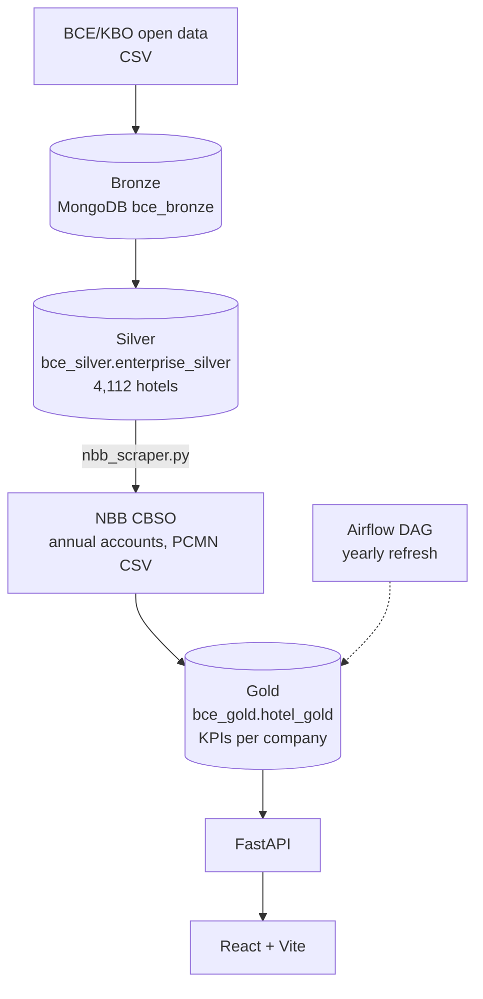

# Belgium Hotels: Medallion Data Platform

End-to-end data pipeline on the **4,112 active Belgian hotel companies** (NACE 55xxx) from the Belgian company register (BCE/KBO). It follows a **Bronze → Silver → Gold** medallion architecture on MongoDB, scrapes published annual accounts from the National Bank of Belgium (NBB), computes financial KPIs, and serves them through a **FastAPI** backend and a **React** frontend. An **Airflow** DAG refreshes the Gold layer every year.


> **Status:** early version. The repository contains the React frontend, the Bronze ingestion script, the Silver helpers and the HDFS init script. The API, the Gold layer, the NBB scraper and the Airflow DAG described below are not part of this repository yet (see [Roadmap](#roadmap)).

## Architecture



| Layer | Content |
|---|---|
| **Bronze** | Raw ingestion state, including scraping progress (`state_nbb_scraping`) |
| **Silver** | One document per hotel: name, address, NACE code, legal form, status |
| **Gold** | One document per company with yearly financials, KPIs and ratios; cached company officers |

Spark was dropped: it ran out of memory in the constrained dev environment, so the Gold layer uses **pandas + a `ThreadPoolExecutor`** (8 workers) instead.

## Tech stack

| Component | Technology |
|---|---|
| Storage | MongoDB 7.0 |
| Scraping | Python, requests, BeautifulSoup |
| Gold computation | Python, pandas, ThreadPoolExecutor |
| API | FastAPI, uvicorn (REST + Server-Sent Events) |
| Frontend | React 18, Vite, axios, SVG Sankey chart |
| Orchestration | Apache Airflow 2.9 |

## Configuration

No secrets live in the repository. Copy `.env.example` to `.env` and set:

```bash
MONGO_URI=mongodb://<user>:<password>@localhost:27017/
```

`.env` is git-ignored. Every script reads its connection details from the environment.

## Pipeline

1. **Silver: load the register.** `silver_transform.py` reads the BCE open-data CSVs and builds `enterprise_silver`.
2. **Scrape accounts.** `nbb_scraper.py --scrape-only --workers 8` lists each hotel's financial filings from 2021 onward on the NBB consultation site, downloads each as a PCMN CSV, and records progress in `state_nbb_scraping`.
3. **Gold: compute KPIs.** `hotel_gold.py` parses the PCMN codes, derives the ratios below and upserts into `hotel_gold`. It is idempotent, so it can be re-run after a partial scrape.

### PCMN codes → Gold fields

| Code | Field | Meaning |
|---|---|---|
| 70 | `ca` | Revenue (full schemas only) |
| 60 | `achats` | Purchases |
| 71 | `var_stocks` | Change in inventory |
| 9901 | `ebit` | Operating result |
| 9904 | `resultat_net` | Net result |
| 54/58 | `tresorerie` | Cash |
| 17 + 43 | `dettes_financieres` | Financial debt |
| 10/15 | `fonds_propres` | Equity |
| 100 | `capital_souscrit` | Subscribed capital |
| 630 | `depreciation` | Depreciation |
| 9906 | `chiffre_affaires_net` | Net revenue (abridged schemas) |

### Ratios

| Ratio | Formula |
|---|---|
| Net margin % | net result / revenue × 100 |
| Gross margin % | (revenue − purchases + inventory change) / revenue × 100 |
| ROE % | net result / equity × 100 |
| EBITDA % | (EBIT + depreciation) / revenue × 100 |
| Liquidity | cash / financial debt |
| Debt ratio % | financial debt / equity × 100 |

Abridged filing schemas (e.g. `m87-f`, `m07-f`) don't publish code 70, so revenue-based ratios are `null` for those companies.

## API

| Method | Endpoint | Description |
|---|---|---|
| GET | `/api/search?q=…` | Search by name or enterprise number (max 20) |
| GET | `/api/enterprise/{num}` | Full profile: silver + gold + scrape status |
| GET | `/api/enterprise/{num}/financials` | Gold KPIs only |
| GET | `/api/enterprise/{num}/dirigeants` | Company officers over SSE, cached after the first scrape |
| GET | `/api/stats` | Scraping progress and Gold counters |

## Airflow

The DAG `bce_hotel_gold_refresh` runs yearly (`0 6 1 1 *`) and is **incremental**: only companies whose number of filings increased since the last run are reprocessed.

```
list_done_enterprises → check_new_deposits → download_new_deposits → recalculate_gold → report
```

## Project snapshot (2026-07-02)

| Layer | State |
|---|---|
| Silver | Complete: 4,112 companies |
| NBB scraping | About 52%: 2,141 of 4,112 companies, 6,898 CSVs |
| Gold | 1,849 companies with KPIs |

## Repository layout

```
Data_Platform/
  bronze/      ingestion
  silver/      BCE transform, NBB scraper and client
  gold/        KPI computation
  api/         FastAPI backend
  frontend/    React + Vite UI (search, financial tabs, Sankey, officers)
  airflow/dags yearly refresh DAG
  scripts/     HDFS init, pipeline runner
```

## Roadmap

- [ ] Restore API, Gold, scraper and DAG with configuration from environment variables
- [ ] Add `docker-compose.yml` for MongoDB and a one-command demo
- [ ] Add a small sample dataset and tests for the KPI formulas
- [ ] Add CI (ruff, pytest)

## Data source and licence

Company data comes from the Belgian BCE/KBO open data; annual accounts from the NBB Central Balance Sheet Office. Check each source's terms of use and attribution requirements before reuse. Raw data is not stored in this repository.
